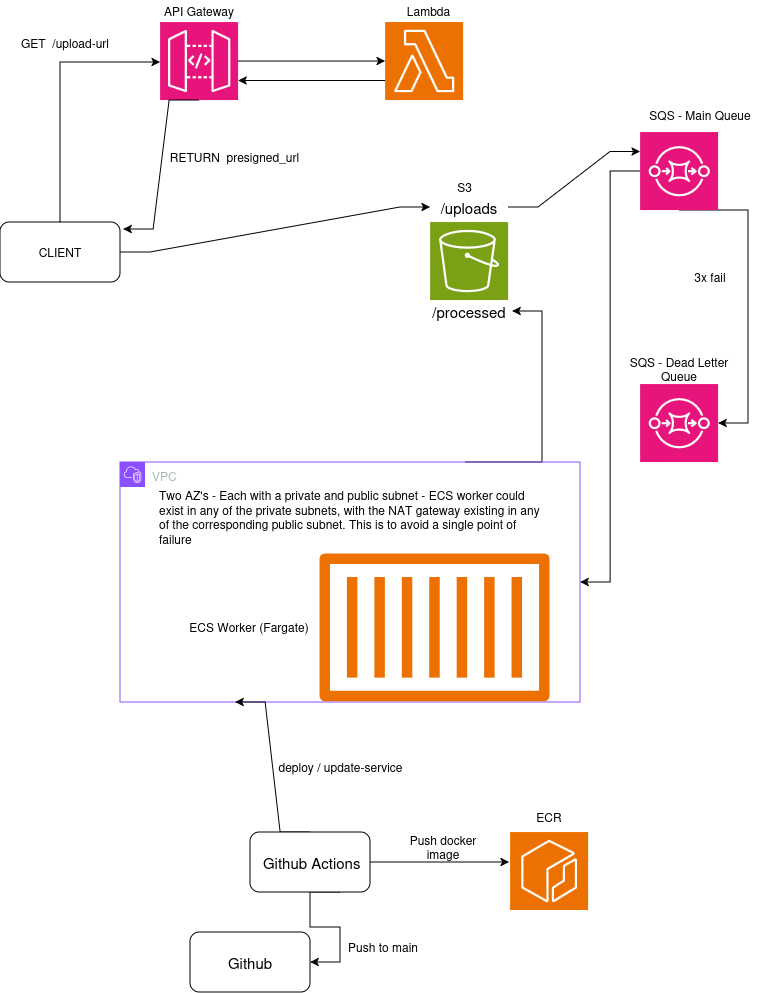

# Image Pipeline

An image gets uploaded, and three resized versions come out the other end (a thumbnail, a medium, and a large) without a server ever sitting around waiting for that upload to happen. That's the whole product. The interesting part is everything underneath it: a presigned-upload API, a queue-decoupled worker fleet that scales itself, a private network the worker can't be reached from, and a CI/CD pipeline that never touches a stored AWS credential.

## Why this exists

This project started as a deliberately small idea: simple enough to actually finish, real enough to teach something. The goal was never "resize images." It was to build, by hand, every layer a real cloud pipeline actually has: async processing, least-privilege IAM, private networking, autoscaling, observability, and a CI/CD pipeline that deploys itself. 

## Architecture



## How a request actually flows

1. **Client asks for somewhere to upload.** `GET /upload-url?filename=photo.jpg` hits API Gateway, which invokes a Lambda function.
2. **Lambda hands back a presigned URL.** It never touches the file itself, it just signs a URL, scoped to one S3 key under `uploads/`, valid for five minutes.
3. **Client uploads directly to S3.** No AWS credentials on the client, ever. The presigned URL is the credential, and it's good for exactly one `PUT`, to exactly one object.
4. **S3 fires an event.** The moment the object lands, S3 notifies an SQS queue, so the upload and the processing are now fully decoupled from each other.
5. **The worker picks it up.** An ECS Fargate task, sitting in a private subnet with no public IP, long-polls the queue, downloads the object, and resizes it into three sizes with Pillow.
6. **Results go back to S3**, under `processed/`.

If a message fails three times (a corrupt upload, a transient error, whatever) it's automatically redirected to a dead-letter queue instead of retrying forever or vanishing silently.

Separately, whenever code lands on `main`: GitHub Actions authenticates to AWS via OIDC (no stored access keys anywhere), runs the test suite, builds and pushes a new worker image to ECR, and deploys it to the running ECS service.

## Tech stack

| Layer | Choice | Why |
|---|---|---|
| Upload API | Lambda + API Gateway | Stateless, low-traffic, bursty: a 24/7 container for this would be paying for idle capacity |
| Processing | ECS on Fargate | Long-running, needs control over runtime/memory for image work, no servers to patch |
| Queue | SQS, with a dead-letter queue | Decouples upload from processing, absorbs bursts, gives real retry/failure semantics for free |
| Storage | S3 | Uploads and processed output live in the same bucket, split by prefix |
| Networking | VPC, 2 AZs, public + private subnets, NAT per AZ | The worker is genuinely unreachable from the internet: not just "we didn't open a port," but architecturally impossible |
| IaC | Terraform | Every resource in this diagram is `terraform apply`, not console clicks |
| CI/CD | GitHub Actions + OIDC | Zero long-lived AWS credentials stored anywhere, ever |
| Observability | CloudWatch custom metrics + alarms | The worker emits its own metrics; alarms watch queue depth, DLQ arrivals, and computed error rate |
| Autoscaling | Application Auto Scaling, target tracking | Scales on *backlog per running task*, not a flat queue-depth number |

## A few decisions worth explaining

**The upload API is Lambda, not ECS**, even though the original design put everything in containers. A presigned-URL endpoint is stateless and cheap to call, and running a 24/7 Fargate service and an ALB just to occasionally hand back a signed URL buys nothing. Mixing serverless glue with a container for the actual work is itself a normal, real-world pattern.

**There's no load balancer anywhere in this architecture**, on purpose. ALB solves "route inbound client requests across several servers," and nothing here has that shape. API Gateway is already the public front door for Lambda, and the worker never receives inbound traffic at all; it only ever reaches *out* to SQS. When multiple worker tasks eventually run at once, SQS itself distributes the work: no load balancer needed to "share" a queue.

**The worker never holds a static AWS credential.** It runs under an ECS task role, which hands it short-lived, auto-rotating credentials with exactly three permissions: read from `uploads/`, write to `processed/`, and the handful of SQS/CloudWatch actions it actually uses. Nothing more.

**Autoscaling tracks backlog-per-task, not raw queue depth.** A flat "if depth > 10, add a worker" rule doesn't know whether 10 messages is nothing or a crisis, since that depends entirely on how many workers already exist. Target tracking asks Application Auto Scaling to keep the ratio (queue depth ÷ running tasks) near 1, and lets AWS work out how many tasks that actually requires.

**Debugging this thing surfaced a few genuinely interesting bugs**: a Terraform security-group replacement that deadlocked because the resource meant to unblock it hadn't been created yet, and a GitHub Actions OIDC trust policy that silently failed because GitHub permanently changes its token's identity claim once an account or repo has ever been renamed. Full writeups, with the actual commands used to diagnose each one, are in [`TROUBLESHOOTING.md`](./TROUBLESHOOTING.md).

## Project structure

```
resize.py            # core resize logic (Pillow), shared by local testing and the worker
worker.py            # long-running SQS consumer: download, resize, upload, emit metrics
upload_handler.py    # Lambda: issues presigned S3 upload URLs
test_resize.py        # pytest, the CI test gate
Dockerfile            # worker container image
terraform/            # every AWS resource, as code
  vpc.tf               # VPC, subnets, NAT, route tables
  main.tf              # S3 bucket, SQS queues
  ecs.tf, ecs-task.tf  # cluster, task definition, service, IAM roles
  lambda.tf, api-gateway.tf
  autoscaling.tf        # target tracking policy
  alarms.tf             # queue depth / DLQ / error-rate alarms
  github-oidc.tf        # CI/CD trust relationship
.github/workflows/     # test -> build -> push -> deploy
```

## Running it

```bash
# spin up the infrastructure
cd terraform
terraform init
terraform apply

# run the test suite
pip install -r requirements-dev.txt
pytest test_resize.py -v

# build and push the worker image
docker build -t image-pipeline-worker .
aws ecr get-login-password --region us-west-2 | docker login --username AWS --password-stdin <account-id>.dkr.ecr.us-west-2.amazonaws.com
docker tag image-pipeline-worker:latest <ecr-repo-url>:latest
docker push <ecr-repo-url>:latest
```

From there, pushing to `main` on GitHub takes over: tests run, a new image builds and pushes, and the ECS service redeploys automatically.

To tear everything down between sessions (this project treats that as a habit, not an afterthought, since a NAT Gateway per AZ isn't free if left running):

```bash
terraform destroy
```

## Current status

Built and verified end-to-end: local resize logic, S3/SQS infrastructure, a containerized worker running on Fargate with a scoped task role, a presigned-upload API with CORS, full VPC networking with the worker in private subnets, a working CI/CD pipeline via OIDC, and CloudWatch alarms + target-tracking autoscaling (confirmed reacting to real metric data).

Not yet built: a small always-on "showcase" deployment separate from the learning stack, a CloudWatch dashboard, and a frontend for uploading/viewing images without the CLI.
